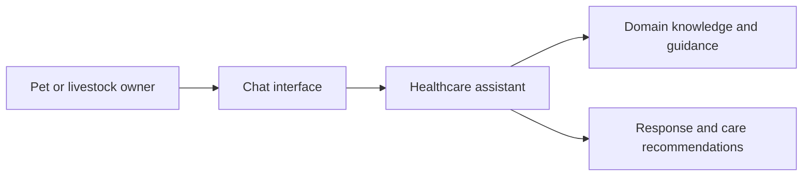

# AI-healthcare-assistant-for-pets-and-livestock-with-chatbot

## Architecture



An AI-powered healthcare assistant designed for pets and livestock. This project provides a chatbox interface that enables users to:

- Ask health-related queries about animals 🐶🐱🐄🐑

- Receive AI-driven suggestions and guidance 💡

- Improve veterinary care accessibility 📈

---

## 🚀 Features

- Chatbox interface for interacting with the assistant

- AI-powered responses tailored for pets and livestock

- Easy-to-use Jupyter Notebook environment

- Extendable for integrating APIs (e.g., veterinary databases, telemedicine platforms)

---

## 📂 Project Structure

├── ai healthcare assistant for pets and livestock with chatbox.ipynb  # Main notebook

└── README.md                                                          # Project documentation

---

## ⚙️ Installation

### 1. Clone the Repository
```bash
git clone https://github.com/AryaLolusare2712/ai-healthcare-assistant.git
cd ai-healthcare-assistant
```

### 2. Install Dependencies

Make sure you have Python 3.8+ and Jupyter Notebook installed. Then install required libraries:
```bash
pip install -r requirements.txt
```

(You can export dependencies from your notebook using !pip freeze > requirements.txt)

### 3. Run the Notebook
```bash
jupyter notebook "ai healthcare assistant for pets and livestock with chatbox.ipynb"
```

---

## 📌 Future Improvements

- Integrate live veterinary databases for accuracy

- Build a web/mobile frontend

- Add voice-based interaction 🎙️

- Include multi-language support 🌍

  
